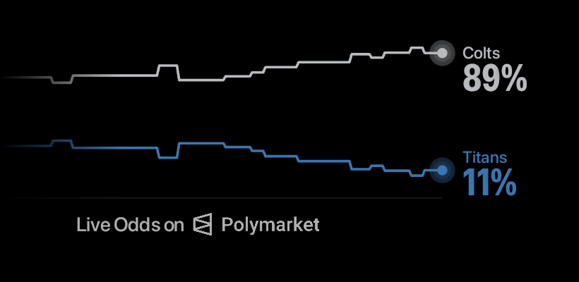
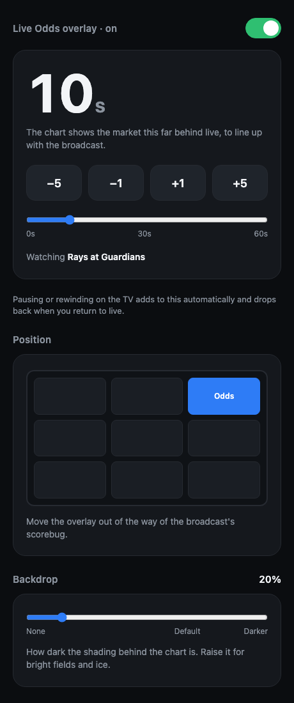
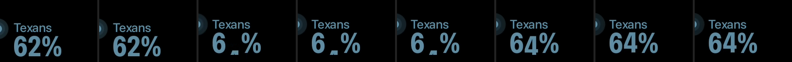

# tv-odds: live Polymarket odds over YouTube TV

A tiny Android TV app that draws a live **Polymarket US win-probability chart** over whatever game
you're watching in **YouTube TV** on a **Chromecast with Google TV** (or any Google TV / Android TV
device). It finds the game on its own, draws the chart in the top-left corner over the video, and runs
a few seconds behind live so price moves line up with the broadcast.



*(Screenshots show black where the video goes: Android blocks capturing DRM video. On the TV the game
plays behind the overlay.)*

- **Finds the game by itself.** It reads the title YouTube TV is playing ("Houston Texans vs.
  Jacksonville Jaguars", "Nebraska at Oregon") and matches it to the Polymarket US moneyline market.
  Change channels and it switches games within a couple of seconds.
- **Draws a hi-fi chart** (Hampel cleaning, fixed time buckets, pixel stabilization, nice axis
  bounds, 2dp linear strokes) in each team's color. The chart
  runs to the left edge of the screen and fades in.
- **Shows live % labels** at pulsing line endpoints in SF Pro Condensed Bold. Changed digits roll like
  an odometer: up from below on an uptick, down from above on a downtick.
- **Adjustable delay.** The market moves about 10–15 s before the broadcast shows the play, so the
  chart runs N seconds behind live. You set N from your phone. Pausing or rewinding on the TV adds to
  the delay automatically.
- **No tokens or accounts.** It uses public Polymarket US endpoints only.

---

## What you need

| | |
|---|---|
| **A Google TV / Android TV device** | Chromecast with Google TV (4K or HD), Google TV Streamer, Nvidia Shield, or a TV running Google TV. Tested on Chromecast with Google TV 4K, Android 14. |
| **YouTube TV, played on that device** | Open YouTube TV **from the device's home screen**. Casting from your phone to a TV's *built-in* Chromecast (LG, Samsung, Vizio) won't work: that runs on the TV's own OS, which can't draw overlays. |
| **A computer on the same Wi-Fi** | Used to build and install (macOS tested; Linux works the same way). It isn't needed after install. |
| **Android SDK** | `platform-tools` (adb), any `build-tools` (34+), and one `platforms;android-34`+. Android Studio installs these, or use `sdkmanager`. |
| **JDK 17+** | e.g. `brew install openjdk@21` |

No Gradle and no third-party libraries. `build.sh` calls `aapt2`, `javac`, `d8` and `apksigner`
directly.

---

## Setup (about 10 minutes)

### 1. Turn on developer mode on the Chromecast

With the Chromecast remote:

1. **Settings → System → About**, scroll to **Android TV OS build** and press OK on it **7 times**
   until it says you're a developer.
2. **Settings → System → Developer options**, then turn on **USB debugging**. Also turn on
   **Wireless debugging** if it's listed (it is on Android 12+ Google TV).

### 2. Pair your computer with it (Wireless debugging)

On the Chromecast, open **Developer options → Wireless debugging → Pair device with pairing code**.
It shows an `IP:port` and a 6-digit code. On your computer:

```bash
adb pair 192.168.1.50:37xxx 123456
```

Use the IP:port from the pairing screen. The screen times out after a minute or so, so pair promptly.
adb then auto-connects over mDNS. Check with:

```bash
adb devices -l
```

Look for `model:Chromecast` (or similar) in the list. If it doesn't auto-connect, use the IP:port
shown under **Wireless debugging → IP address & port** (it's different from the pairing port):

```bash
adb connect 192.168.1.50:4xxxx
```

> **Older Google TV builds without "Wireless debugging":** USB debugging alone opens adb on port
> 5555: `adb connect <ip>:5555`, then accept the **"Allow USB debugging?"** prompt on the TV (tick
> *Always allow*).
>
> **Finding the device's IP:** Settings → Network & Internet → your Wi-Fi network. Or from a Mac, run
> `dns-sd -B _androidtvremote2._tcp` and resolve the entry it finds.

### 3. Build and install

```bash
./build.sh      # -> build/tvodds.apk
./install.sh    # installs, grants permissions, starts the overlay
```

`install.sh` does three things over adb:

1. Installs the APK.
2. Grants two permissions that Google TV hides from its settings screens:
   - `appops set com.tvodds SYSTEM_ALERT_WINDOW allow` lets the app draw over other apps.
   - `cmd notification allow_listener com.tvodds/com.tvodds.MediaListener` lets the app see what
     YouTube TV is playing (the title comes from the active media session).
3. Starts the overlay.

About the second permission: Android only lets an app read other apps' media sessions if it's a
notification listener, which in principle also gives it access to notifications. This app only reads
the media session. `MediaListener` is empty and never reads a notification.

If more than one device is connected, set `ANDROID_SERIAL=<serial from adb devices>` first.

### 4. Watch a game

Open YouTube TV on the Chromecast and start a game with a Polymarket US market. The chart fades in
within a few seconds. **Your computer isn't needed after this.** The overlay runs on the Chromecast
and restarts by itself after a reboot.

### 5. Turn off Wireless debugging (recommended)

Once it's installed, turn off **Settings → System → Developer options → Wireless debugging** (and USB
debugging) on the Chromecast. The overlay keeps working. Turn it back on only when you want to install
an update; your computer stays paired, so `adb devices` reconnects.

---

## Daily use

### Turning it on and off
**Odds Overlay** appears in the Google TV apps row. Opening it toggles the overlay on or off (you'll
see a short toast message).

### Setting the delay (from your phone)



The overlay serves a small control page on your home network:

```
http://<chromecast-ip>:8765
```

Open it on your phone. The address is also printed in the logs as `control page at http://…`.

- **−5 / −1 / +1 / +5** or the slider (0–60 s) set the base delay. The TV updates immediately and
  the game keeps playing. The setting is saved on the device. The default is **20 s**.
- **Pausing or rewinding is handled automatically.** The overlay tracks YouTube TV's playback
  position. If you pause for 2 minutes, the chart falls 2 minutes further behind, so it stays in sync
  with what you're watching. Jump back to live and the extra delay goes away. The page shows this as
  *"paused/rewound +120s (total 140s)"*.

**Where to start:** from watching NFL games on YouTube TV, these delays lined up well, depending on
YouTube TV's own delay setting:

| YouTube TV delay setting | Odds delay |
|---|---|
| Moderate | about 20 s |
| Decreased | about 10 s |

Your numbers may differ with your connection, the broadcasting network and so on.

**Tuning tip:** wait for a big play (a touchdown or turnover). If the chart reacts before the TV
shows the play, add delay; if it reacts after, remove some.

### The odometer



When a % changes, only the digits that changed roll. On an uptick the new digit rises from below; on
a downtick it drops in from above. It overshoots by 6% and settles over 350 ms.

---

## How it works

```
YouTube TV (com.google.android.youtube.tvunplugged)
   │  MediaSession: title "Nebraska at Oregon", play state, playback position
   ▼
OverlayService ──(every 2 s)── Poly.find(title)
   │                              │  GET gateway.polymarket.us/v2/leagues/{league}/events
   │                              │  (nfl, cfb, nba, nhl, mlb, cbb, wnba, mls, epl, …; cached 5 min)
   │                              ▼  match both team names → event + moneyline market slug
   │
   ├─ price history (once per game)  GET /v1/price-history?symbol=<market>&fidelity=1
   │     longPrice = away-team probability; book-coherence filter; clamped to kickoff
   ├─ live price                     wss://gateway-ws-markets.polymarket.us/v1/ws/markets
   │     SUBSCRIPTION_TYPE_MARKET_DATA_LITE → currentPx  (falls back to GET /v1/markets/<m>/bbo)
   ├─ delay                          cutoff = now − base delay − DVR lag
   └─ ControlServer :8765            phone page + /api, /set, /nudge
   ▼
OddsView (TYPE_APPLICATION_OVERLAY window, top-left, not focusable or touchable)
   hi-fi chart pipeline → team-color lines → pulsing endpoints → odometer % labels
```

### Matching a broadcast to a market

- **Parsing the title:** the YouTube TV title is split into two sides on `at` / `vs.` / `v` / `@`.
  Prefixes like `College Football:`, rankings (`#7`, `No. 7`) and suffixes like `(Replay)` are
  removed.
- **Matching teams:** each side is compared with every team in the league listings by `name`,
  `alias`, `safeName`, `name + alias` and abbreviation. "Philadelphia" also matches "Philadelphia
  Eagles".
- **Choosing a game:** both teams must match. Exact name matches win, then live games, then the game
  closest to now.
- **Away and home:** the event title runs away-first, and the moneyline's long side is the away
  team (`longPrice` = away-team probability).

### The chart

The pipeline is in `Chart.java`. Its constants are tuned together for the stepped look, so change
them with care:

`hampelClean` → pin tick → bucket sampling → `niceAxisBounds` → map to dp → `stabilizePx` → 2dp
linear polyline

Two changes for a live TV display:

- **Fixed clock grid:** buckets are aligned to fixed clock times (`Chart.gridSlices`, e.g. every
  15 s on :00/:15/:30), not stretched across a growing window. Older history samples the same way
  every frame, so the steps don't shimmer as the window grows.
- **Locked y-axis:** the bounds widen only when the price breaks out of range, and tighten only once
  the data spans less than half of the axis. A single tick never rescales the chart.

### Colors

Team colors come from Polymarket US's dark-theme variant (`teams[].color.dark`), brightened to at
least 0.82 HSV value so they read over video while keeping their hue. If the two teams' colors are
nearly identical, home switches to light grey.

---

## Project layout

```
AndroidManifest.xml       app, overlay service, media listener, boot receiver
build.sh                  aapt2 → javac → d8 → zipalign → apksigner (no Gradle)
install.sh                adb install + permission grants + start
assets/pm_logo.png        Polymarket logo (white)
assets/fonts/             SF Pro Condensed Bold (% labels), SF Pro Display Medium (names, caption)
docs/                     README images
src/com/tvodds/
  OverlayService.java     the brain: what's playing, game lookup, live prices, delay, rendering cadence
  Poly.java               Polymarket US REST: league listings, matching, price history, /bbo
  WsClient.java           ~150-line RFC 6455 websocket client (TLS, fragmentation, ping/pong)
  Chart.java              hi-fi chart pipeline + clock-grid slicing
  OddsView.java           the overlay view: gradient, chart, pulse, odometer, brand row
  ControlServer.java      LAN control page on :8765
  ToggleActivity.java     launcher icon → on/off
  MediaListener.java      empty NotificationListenerService (needed to read media sessions)
  BootReceiver.java       restarts the overlay after a reboot
```

### Changing things

| To change | Where |
|---|---|
| Default delay / max delay | `OverlayService.DEFAULT_DELAY_S`, `MAX_DELAY_S` |
| Which leagues are searched, and in what order | `Poly.LEAGUES` (slugs from `GET /v2/leagues`) |
| Overall overlay size | `OddsView.SCALE` (0.9; 1.0 = authored size) |
| Position and size of the chart | `OddsView`: `PLOT_R`, `Y0`, `PLOT_H`, `BRAND_X`, `VIEW_W/H` |
| Left-edge fade length | `OddsView.FADE_W` |
| Corner gradient strength | the `RadialGradient` colors in the `OddsView` constructor |
| Label sizes / fonts | `OddsView` constructor (`name`, `pct`, `caption` paints) |
| Odometer timing | `OddsView.ROLL_MS`, `flipOffsetFrac` |
| Pulse speed | `OddsView.PULSE_MS` |
| Control page port | `ControlServer.PORT` |

After any change, rebuild and reinstall:

```bash
./build.sh && ./install.sh
```

If Android refuses the update because of a version downgrade, bump it with
`VERSION_CODE=<n> ./build.sh`.

---

## Troubleshooting

All logging uses the tag `tvodds`:

```bash
adb logcat -s tvodds
```

A healthy start looks like this:

```
overlay service started
control page at http://192.168.1.50:8765
now playing: "Houston Texans vs. Jacksonville Jaguars"
matched "Houston Texans vs. Jacksonville Jaguars" -> nfl-hou-jax-2026-10-18 (aec-nfl-hou-jax-2026-10-18)
history 154 pts for aec-nfl-hou-jax-2026-10-18
ws subscribed aec-nfl-hou-jax-2026-10-18
```

| Symptom | Fix |
|---|---|
| `media sessions not readable` | The listener permission is missing: `adb shell cmd notification allow_listener com.tvodds/com.tvodds.MediaListener` |
| Toast says "Overlay permission missing" | `adb shell appops set com.tvodds SYSTEM_ALERT_WINDOW allow` |
| `no market for "…"` | That game has no Polymarket US moneyline, its league isn't in `Poly.LEAGUES`, or the title format didn't parse (check the logged title). |
| Nothing logs `now playing` | YouTube TV must be playing **on the device**, not cast to a TV's built-in Chromecast. |
| `adb` can't find the device after a reboot | The Wireless debugging port changes. Run `adb devices` (mDNS usually reconnects), or reopen *Wireless debugging* for the new IP:port. Pairing is remembered. |
| macOS: `adb connect` says *No route to host* although the port is open | macOS Local Network privacy can block Google's `adb` binary. Allow it under System Settings → Privacy & Security → Local Network, or run adb from a terminal app that already has access. |
| Control page doesn't load | Your phone must be on the same Wi-Fi. Check the IP in `control page at …` in the logs. |
| `INSTALL_FAILED_UPDATE_INCOMPATIBLE` / signatures don't match | It was installed from another machine, and each checkout generates its own `debug.keystore`. Run `adb uninstall com.tvodds` first; your delay setting resets to 20 s. |
| Uninstall | `adb uninstall com.tvodds` |

---

## Limitations and notes

- **YouTube TV only.** Other apps would only need their package name added in `OverlayService`, as
  long as their media session reports a "Team at Team" style title.
- **Moneyline only.** The Polymarket US league listing returns one moneyline per game. Spreads and
  totals would need another data source.
- **Delay is time-based, not synced to the broadcast.** The base delay is a constant you tune. The
  pause/rewind offset is measured, but the broadcast's own latency varies a little by channel and
  network.
- **The control page has no authentication.** Anyone on your Wi-Fi can change the delay, and that's
  all it can do.
